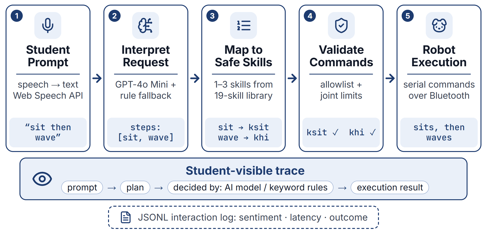
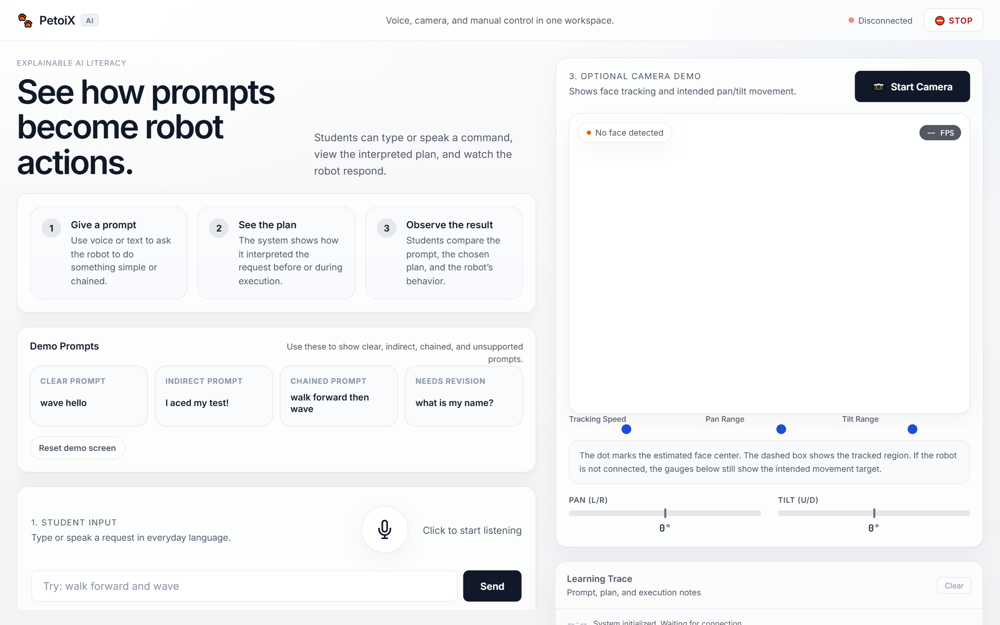
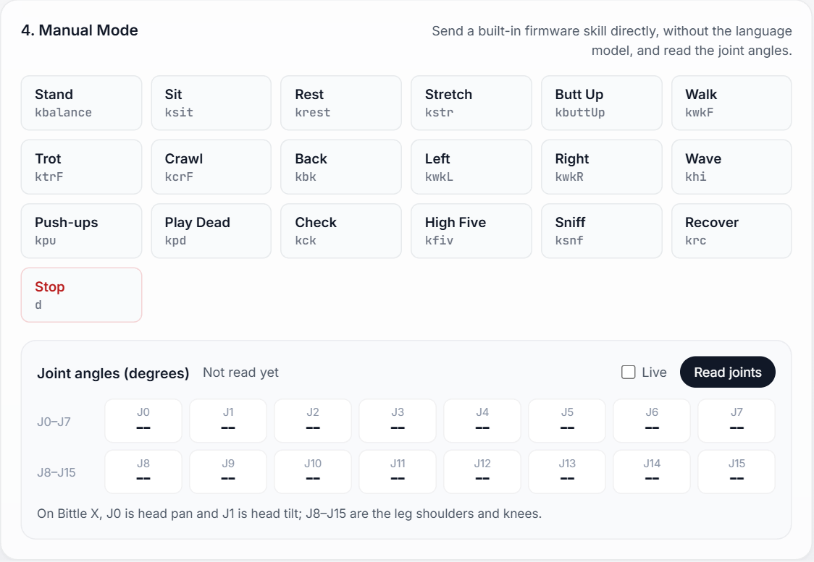

# PetoiX

**A voice-controlled robotics interface for middle school AI learning.**

PetoiX is a browser-based interface for the [Petoi Bittle X](https://www.petoi.com/) robot dog.
It lets students see each step between a natural-language request and a physical robot action.
This repository is the companion code for:

> Priyanka Kumar, Panhapiseth Lim, and Kara Rosenblatt. 2027.
> **PetoiX: A Voice-Controlled Robotics Interface for Middle School Students AI Learning.**
> In *Proceedings of the 58th ACM Technical Symposium on Computer Science Education V.2 (SIGCSE TS 2027)*,
> Sacramento, CA, USA. ACM. [doi:10.1145/3857223.3863059](https://doi.org/10.1145/3857223.3863059)



*Figure 2 from the paper: the prompt-to-action pipeline that PetoiX shows to students.*

---

## Contents

- [What PetoiX does](#what-petoix-does)
- [How a prompt becomes an action](#how-a-prompt-becomes-an-action)
- [Quick start](#quick-start)
- [Using the three modes](#using-the-three-modes)
- [Classroom activity](#classroom-activity)
- [Safety](#safety)
- [Logs and reproducibility](#logs-and-reproducibility)
- [Tests](#tests)
- [API and WebSocket events](#api-and-websocket-events)
- [Repository layout](#repository-layout)
- [Citation](#citation)
- [Acknowledgments](#acknowledgments)

## What PetoiX does



One browser workspace offers three interaction modes:

| Mode | What students do | How it works |
|---|---|---|
| **Voice Mode** | Speak or type a request such as *"sit then wave"* | The Web Speech API turns speech into text. Keyword rules or GPT-4o Mini map the text to 1–3 skills, and the commands are streamed to the robot over Bluetooth. |
| **Camera Tracking Mode** | Move in front of the webcam | Skin-color and region tracking on a browser canvas sends head pan/tilt targets over a WebSocket. An on-screen badge shows the measured vision-loop rate. |
| **Manual Mode** | Press one of **19 quick-action triggers** and read the joint angles | Built-in firmware skills are sent directly, without the language model. The joint readout shows J0–J7 (head) and J8–J15 (legs). |

Every request produces a **student-visible trace** (prompt → plan → *decided by: AI model / keyword rules* → execution result).
The trace appears in the interface, is pushed live over WebSockets, and is saved to a JSONL interaction log.

## How a prompt becomes an action

The five stages in Figure 2 map directly to the code in `server.py`:

| Stage | Code | Details |
|---|---|---|
| 1. Student prompt | `app.js` → `POST /api/command` | Speech is transcribed in the browser with the Web Speech API (Chrome or Edge). |
| 2. Interpret request | `call_llm()` | **Keyword rules first.** Exact skill names (`"sit"`), negated requests (`"don't walk"`) and non-action questions (`"what is my name?"`) are handled without calling a model. **GPT-4o Mini otherwise.** Everything else goes to `openai/gpt-4o-mini` through OpenRouter, which may only return skill IDs from the library. **Rule fallback.** If the model is unavailable, returns invalid JSON, names unknown skills, or no API key is set, `infer_steps_from_text()` builds the plan from keywords. |
| 3. Map to safe skills | `plan_actions()`, `SKILL_LIBRARY` | Each plan has 1–3 steps (`MAX_PLAN_STEPS = 3`) taken from a **19-skill library**, and each skill expands to fixed firmware commands (`sit → ksit`, `wave → khi`). |
| 4. Validate commands | `validate_command()` | Each command must be on the allowlist, and joint moves must be within per-joint angle limits. |
| 5. Robot execution | `SerialManager.send()` | Commands are sent one at a time over Bluetooth or USB serial, with timed pauses and auto-reconnect. |

Example run (from [`docs/demo_transcript.md`](docs/demo_transcript.md), recorded with the robot connected):

```text
"sit then wave"  →  decided by: AI model (gpt-4o-mini), confidence 0.95
                 →  plan [sit, wave]  →  ksit ✓  khi ✓  →  robot sits, then waves
```

## Quick start

Requirements: Python 3.10+, Chrome or Edge (for the Web Speech API), and a Petoi Bittle X paired over Bluetooth or connected by USB.
An [OpenRouter](https://openrouter.ai/) API key is optional. Without one, every request goes through the keyword-rule planner.

```bash
git clone https://github.com/BryanLim0214/PetoiX.git
cd PetoiX
python -m venv .venv
# Windows: .venv\Scripts\activate    macOS/Linux: source .venv/bin/activate
pip install -r requirements.txt
cp .env.example .env        # then edit COM_PORT and OPENROUTER_API_KEY
python server.py
```

Then open **http://localhost:8080**.
If the robot is not connected, the server starts in demo mode and reconnects automatically on the next command.

Finding the port: run `python test_com.py`, or call `GET /api/ports`.
On Windows the port looks like `COM5`, on macOS `/dev/cu.*`, and on Linux `/dev/rfcomm0` or `/dev/ttyUSB0`.

## Using the three modes

**Voice Mode.** Click the microphone and say a request, or type it and press **Send**.
The *Interpreted Plan and Result* card shows the plan, which interpreter decided it, the commands sent and the robot's replies.
The four **Demo Prompts** show a clear prompt, an indirect one (*"I aced my test!"*), a chained one, and one that needs revision.

**Camera Tracking Mode.** Click **Start Camera**. The dashed box is the tracked region and the dot is its center.
The head follows the target, and the pan/tilt gauges show the intended angles even when no robot is connected.
Use the sliders to change tracking speed and range.

**Manual Mode.** Each of the 19 buttons sends one built-in skill of the Bittle X firmware:



| Postures | Gaits | Tricks | Stop |
|---|---|---|---|
| `kbalance` Stand, `ksit` Sit, `krest` Rest, `kstr` Stretch, `kbuttUp` Butt Up | `kwkF` Walk, `ktrF` Trot, `kcrF` Crawl, `kbk` Back, `kwkL` Left, `kwkR` Right | `khi` Wave, `kpu` Push-ups, `kpd` Play Dead, `kck` Check, `kfiv` High Five, `ksnf` Sniff, `krc` Recover | `d` rest all servos |

Click **Read joints**, or tick **Live**, to poll the firmware `j` command.
On Bittle X, J0 is head pan, J1 is head tilt, and J8–J15 are the leg shoulders and knees.

Press **STOP** or **Esc** at any time to send `d` and relax all servos.

## Classroom activity

[`docs/classroom-activity.md`](docs/classroom-activity.md) contains the 45-minute **Prompt Debugging** activity from Section 3 of the paper (*Predict → Inspect → Debug & Reflect*), with a student worksheet.

## Safety

- **Allowlist, not blocklist.** Only named skills, a few safe tokens (`d`, `j`, `p`) and joint moves within per-joint limits can reach the robot. Calibration and firmware-write commands (`c`, `s`, `K`, `a`) are rejected with HTTP 403, and the attempt is logged.
- **The model cannot send raw commands.** GPT-4o Mini only returns skill IDs. Application code turns those IDs into commands.
- **Local only by default.** The server binds to `127.0.0.1`, CORS is limited to the local origin, and only `index.html`, `app.js` and `style.css` are served, so `.env` and logs are never exposed.
- **Physical robot.** Keep a clear area around the robot and stay within reach of the STOP button.

## Logs and reproducibility

- Every request is appended to `interaction_logs.jsonl`: prompt, sentiment, plan, planner source, commands, robot replies and `latency_ms`. The file is git-ignored because it contains student prompts.
- `python reproduce_demo.py` (with the server running) replays the paper's demonstration inputs and regenerates [`docs/demo_transcript.md`](docs/demo_transcript.md) and [`docs/demo_results.jsonl`](docs/demo_results.jsonl).
- `python docs/figures/build_fig2.py` regenerates Figure 2 as PNG and vector PDF. It uses Playwright with Edge and the Lucide icons in `docs/figures/icons`.
- [`docs/RESEARCH_LOG.md`](docs/RESEARCH_LOG.md) records the design decisions (constrained skill planner, explainable trace, allowlist validation) and the literature behind them.

## Tests

The offline tests need no robot and no API key. They replace the serial port with a fake one:

```bash
python -m unittest discover -s tests -v
```

The tests cover the rule-based pipeline (direct skill names, chained prompts, negation, questions, the 3-step cap), the allowlist (all 19 manual actions accepted, calibration rejected), joint-table parsing, static-file restrictions, and the WebSocket events.
`python test_pipeline.py` runs end-to-end checks against a running server with a real robot.

## API and WebSocket events

| Endpoint | Purpose |
|---|---|
| `GET /api/status` | Connection status, port, model, serial health |
| `POST /api/command` `{"text": ...}` | Natural-language request → plan, trace, commands, robot replies |
| `POST /api/direct` `{"cmd": ...}` | One allowlisted firmware command (Manual Mode) |
| `GET /api/joints` | Joint angles parsed from the firmware `j` table |
| `POST /api/stop` | Emergency stop (`d`) |
| `POST /api/reconnect`, `GET /api/ports` | Serial port management |

Socket.IO events sent by the server: `status`, `plan`, `command_progress` and `command_complete`.
Event received from the browser: `track` `{pan, tilt}`, which streams Camera Tracking Mode head targets and is validated against joint limits.

## Repository layout

```text
PetoiX/
├── server.py              # Flask + Socket.IO bridge: interpreter, planner, validator, serial manager
├── index.html             # Unified workspace (Voice, Camera, Manual, Learning Trace)
├── app.js                 # Browser logic: speech, vision loop, manual mode, live trace
├── style.css
├── requirements.txt
├── .env.example
├── tests/test_offline.py  # Offline tests (fake serial port, no API key)
├── test_pipeline.py       # End-to-end checks against a running server
├── reproduce_demo.py      # Regenerates docs/demo_transcript.md and docs/demo_results.jsonl
├── test_com.py            # Find the robot's serial port
├── do_action.py           # Minimal serial smoke test (sends khi)
├── CITATION.cff
└── docs/
    ├── classroom-activity.md
    ├── demo_transcript.md, demo_results.jsonl
    ├── RESEARCH_LOG.md
    └── figures/           # Figure 2 (PNG/PDF + generator + icons), screenshots
```

## Citation

```bibtex
@inproceedings{kumar2027petoix,
  author    = {Kumar, Priyanka and Lim, Panhapiseth and Rosenblatt, Kara},
  title     = {PetoiX: A Voice-Controlled Robotics Interface for Middle School Students AI Learning},
  booktitle = {Proceedings of the 58th ACM Technical Symposium on Computer Science Education V.2},
  series    = {SIGCSE TS 2027},
  year      = {2027},
  location  = {Sacramento, CA, USA},
  publisher = {ACM},
  doi       = {10.1145/3857223.3863059}
}
```

## Acknowledgments

- [Petoi OpenCat](https://github.com/PetoiCamp/OpenCat-Quadruped-Robot) firmware and the Bittle X robot.
- [Lucide](https://lucide.dev) icons (ISC license) in Figure 2.
- [Socket.IO](https://socket.io) and [Flask-SocketIO](https://flask-socketio.readthedocs.io) for the live trace.
- [OpenRouter](https://openrouter.ai) for access to GPT-4o Mini.
